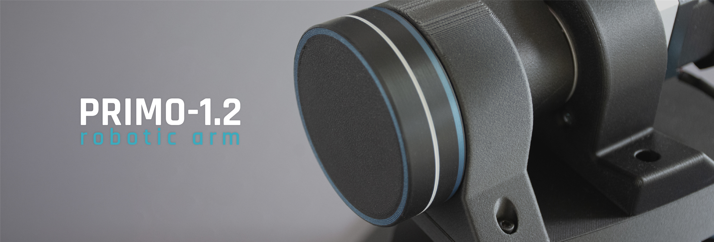

# PRIMO-1.2

### The open source 6-axis robotic arm, fully 3D printable

PRIMO is the open source anthropomorphic manipulator designed and built by [CreaRobotics](https://www.crearobotics.com/it/) for STEM education. This repository contains everything you need to build it. For the complete guide, see the [official manual](https://crearobotics.github.io/PRIMO-Docs/cos_e_la_robotica/). For questions, advice, or simply to show us your PRIMO, join our [Discord server](https://discord.com/invite/ezhwUz77eK).

---

## Table of Contents

- [What's New in Version 1.2](#whats-new-in-version-12)
- [Key Features](#key-features)
- [Description](#description)
- [Repository Contents](#repository-contents)
- [Getting Started](#getting-started)
- [Print Files](#print-files)
- [Community](#community)
- [Contributing](#contributing)
- [Safety Warnings](#safety-warnings)

---

## What's New in Version 1.2

PRIMO-1.2 introduces four main changes affecting the kinematics, the end-effector interface, the power electronics, and the CMF of the manipulator.

| # | Change | Area | Main Benefit |
|:-:|---|---|---|
| 1 | **CMF restyling** | Color, Material, Finish | New visual identity consistent with the CreaRobotics brand |
| 2 | **Soft start board** | Power electronics | Gradual startup and reduced stress on components |
| 3 | **New End Of Tool (EOT) interface** | End-effector interface | Simple, robust, and modular end-effector replacement |
| 4 | **Spherical wrist** | Mechanics | Wider end-effector orientation range and an architecture aligned with industrial robots |

If you prefer to see them in action, the 1.2 updates are also presented on our [YouTube channel](https://www.youtube.com/@CreaRobotics) and in previews posted on [Instagram](https://www.instagram.com/crea.robotics).

### 1. CMF Restyling (Color, Material, Finish)

**What changes:** the 1.2 restyling concerns the **CMF** of the manipulator, meaning the combination of color, material, and surface finish of the printed parts. The geometry and function of the components are not affected by this change.

| Element | 1.2 |
|---|---|
| **Color** | Cobalt Blue, the color of the new CreaRobotics identity |
| **Material** | PLA Metal filament |
| **Finish** | Metallic finish, obtained directly from the filament without post-processing |

### 2. Soft Start

Version 1.2 introduces a **soft start board** in the power supply circuit.

**Why it matters:**
- the system powers up in a gradual and controlled way;
- initial stress on mechanical and electronic components is reduced;
- overall reliability and service life of the system are increased.

### 3. New End Of Tool (EOT) Interface

The end of the arm integrates a new **End Of Tool (EOT)** interface, designed for mounting grippers and interchangeable tools.

**Why it matters:**
- simplifies replacing the end-effector (grippers, suction cups, custom tools);
- provides a robust and repeatable connection between arm and tool;
- paves the way for community-developed tools: if you design one, share it with us on [Discord](https://discord.com/invite/ezhwUz77eK).

### 4. Spherical Wrist

The wrist adopts a spherical configuration, in which the rotation axes of the three wrist joints intersect at a single point.

**Why it matters:**
- improves the end-effector's ability to orient itself in space;
- brings the architecture of PRIMO closer to that of industrial manipulators, adding educational value;
- makes it possible to separate the **position** problem of the wrist from the **orientation** problem of the tool, simplifying the study and calculation of inverse kinematics.

---

## Key Features

| Feature | Description |
|---|---|
| **6 degrees of freedom** | Anthropomorphic manipulator with an open kinematic chain, inspired by industrial robots |
| **Spherical wrist** | Greater freedom in orienting the end-effector |
| **Harmonic drives** | Smooth and precise movements |
| **Open hardware** | 3D printing files freely available |
| **Accessible electronics** | Architecture based on Duet, simple to configure and program |
| **Software compatibility** | Supports professional simulation and programming software such as **RoboDK** |
| **End Of Tool (EOT)** | Interface designed for interchangeable tools and accessories |
| **Soft start** | Gradual and controlled system startup |
| **Modular structure** | Easy to assemble, repair, upgrade, and modify |

---

## Description

PRIMO is an open source 6-axis robotic arm, produced mainly through 3D printing. It is designed for educational and training purposes, to make the world of robotics accessible to as many people as possible.

PRIMO offers a concrete platform on which to study, experiment with, and apply the fundamental concepts of **mechanics**, **electronics**, **control**, and **programming**. To explore these topics further, the [official manual](https://crearobotics.github.io/PRIMO-Docs/cos_e_la_robotica/) starts from the basics of robotics.

---

## Repository Contents

| Folder | Contents |
|---|---|
| [`01-CAD`](01-CAD) | 3D printing files and assembly manuals |
| [`02-BOM`](02-BOM) | Bills of materials for mechanical and electrical components |
| [`03-Digital Twin`](03-Digital%20Twin) | Digital twin of PRIMO, usable with RoboDK |
| [`04-OS`](04-OS) | Operating system image for Raspberry Pi, with pre-installed tools and configurations |

---

## Getting Started

1. **Read the documentation** – Start with the [official PRIMO manual](https://crearobotics.github.io/PRIMO-Docs/cos_e_la_robotica/).
2. **Print the parts** – Download the files from the [`01-CAD`](01-CAD) folder or from the [printing platforms](#print-files).
3. **Source the components** – Check the lists in the [`02-BOM`](02-BOM) folder.
4. **Assemble the robot** – Follow the [mechanical assembly guide](https://crearobotics.github.io/PRIMO-Docs/) and the [electrical wiring diagram](https://crearobotics.github.io/PRIMO-Docs/).
5. **Install the software** – Prepare the Raspberry Pi with the image contained in [`04-OS`](04-OS).
6. **Simulate and program** – Use the digital twin in [`03-Digital Twin`](03-Digital%20Twin) with RoboDK.

If anything is unclear during assembly, you can ask the community on [Discord](https://discord.com/invite/ezhwUz77eK): it's the fastest way to get an answer.

---

## Print Files

In addition to the [`01-CAD`](01-CAD) folder in this repository, the official files are published on [MakerWorld](https://makerworld.com/it/models/3637045-primo-1-2#profileId-4179130) and [Printables](https://www.printables.com/?lang=it), where you can also upload photos of your print.

### What if something breaks?

No problem: every printed component can be reprinted on your own, without waiting for a spare part. In the [`01-CAD`](01-CAD) folder you'll find STL files optimized for printing. You can also experiment with different parameters and materials, first verifying their mechanical and thermal suitability.

---

## Community

PRIMO grows thanks to the people who build it, use it in the classroom, and modify it. The main meeting point is our [Discord server](https://discord.com/invite/ezhwUz77eK), where you can get support, exchange ideas with other makers and educators, and share your projects. We publish assembly tutorials and demos on [YouTube](https://www.youtube.com/@CreaRobotics), while on [Instagram](https://www.instagram.com/crea.robotics) we share news, previews, and the most interesting work from the community: tag **@crea.robotics** when you post your PRIMO. To learn more about who we are and what we do, visit the [CreaRobotics website](https://www.crearobotics.com/it/).

- **Discord:** [Join the CreaRobotics server](https://discord.com/invite/ezhwUz77eK)
- **Instagram:** [crea.robotics](https://www.instagram.com/crea.robotics)
- **Facebook:** [Crea Robotics](https://www.facebook.com/crea.robotics.3D/)
- **LinkedIn:** [Crea Robotics](https://www.linkedin.com/company/crea-robotics)
- **YouTube:** [CreaRobotics](https://www.youtube.com/@CreaRobotics)

---

## Contributing

PRIMO is an evolving project, and every contribution is welcome. If you find a problem, you can open an [Issue](../../issues); if you want to propose an improvement to the CAD files, documentation, or code, you can submit a [Pull Request](../../pulls). For ideas still in the early stages, or if you'd prefer to discuss them first, reach out on [Discord](https://discord.com/invite/ezhwUz77eK).

When reporting a problem, please include, where possible:

- the PRIMO version used;
- the component or subsystem involved;
- a description of the behavior observed;
- the steps needed to reproduce the problem;
- photos, videos, logs, or other material useful for diagnosis.

---

## Safety Warnings

> [!CAUTION]
> Before assembling or using PRIMO, carefully read the following instructions.

- **Stable installation** – Install the robot on a solid, stable surface, leaving enough space around the manipulator to avoid impacts and collisions during movement.
- **Emergency behavior** – Cutting the power or activating the emergency stop (**E-Stop**) button may cause the arm to lower slightly. Although the movement is cushioned, **do not touch the robot while the emergency stop is activated**, to avoid crushing or collisions.
- **Operating environment** – Do not use PRIMO outdoors, in humid environments, near water, or in hazardous areas (for example, where flammable gases are present).
- **Heat and temperature** – The robot and motors can generate heat during operation. Do not touch the manipulator, especially the motor area, during use or immediately after prolonged use.
- **Safety distance** – When PRIMO is active, keep an adequate distance from moving parts. The emergency stop button must always be easily and quickly reachable.

---

*Designed and built with ❤️ by [CreaRobotics](https://www.crearobotics.com/it/) · [Crea3D](https://www.crea3d.com/it/)*

[Read in Italian](README.md)

