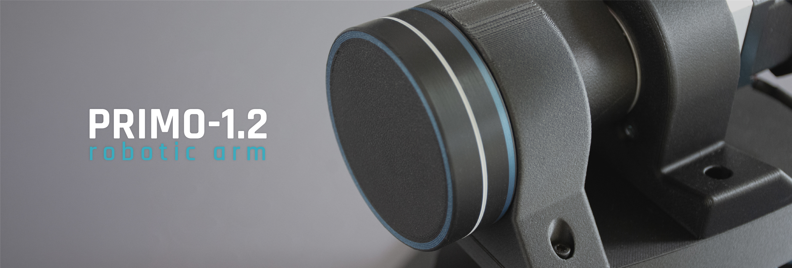

# PRIMO-1.2

### Il braccio robotico open source a 6 assi, interamente stampabile in 3D

PRIMO è il manipolatore antropomorfo open source progettato e realizzato da [CreaRobotics](https://www.crearobotics.com/it/) per la formazione STEM. In questa repository trovi tutto il necessario per costruirlo. Per la guida completa puoi consultare il [manuale ufficiale](https://crearobotics.github.io/PRIMO-Docs/cos_e_la_robotica/), mentre per domande, consigli o semplicemente per mostrarci il tuo PRIMO ti aspettiamo sul nostro [server Discord](https://discord.com/invite/ezhwUz77eK).

---

## Indice

- [Novità della versione 1.2](#novità-della-versione-12)
- [Caratteristiche principali](#caratteristiche-principali)
- [Descrizione](#descrizione)
- [Contenuto della repository](#contenuto-della-repository)
- [Per iniziare](#per-iniziare)
- [File di stampa](#file-di-stampa)
- [Community](#community)
- [Contribuire](#contribuire)
- [Avvertenze di sicurezza](#avvertenze-di-sicurezza)

---

## Novità della versione 1.2

PRIMO-1.2 introduce quattro modifiche principali, che interessano la cinematica, l’interfaccia con l’end-effector, l’elettronica di potenza e il CMF del manipolatore.

| # | Modifica | Area | Beneficio principale |
|:-:|---|---|---|
| 1 | **Restyling CMF** | Color, Material, Finish | Nuova identità visiva coerente con il marchio CreaRobotics |
| 2 | **Board di soft start** | Elettronica di potenza | Accensione graduale e minori sollecitazioni sui componenti |
| 3 | **Nuova interfaccia End Of Tool (EOT)** | Interfaccia end-effector | Sostituzione dell’end-effector semplice, robusta e modulare |
| 4 | **Spherical wrist** | Meccanica | Orientamento dell’end-effector più ampio e architettura allineata ai robot industriali |

Se preferisci vederle in azione, le novità della 1.2 sono presentate anche sul nostro [canale YouTube](https://www.youtube.com/@CreaRobotics) e nelle anteprime pubblicate su [Instagram](https://www.instagram.com/crea.robotics).

### 1. Restyling CMF (Color, Material, Finish)

**Cosa cambia:** il restyling della 1.2 riguarda il **CMF** del manipolatore, cioè l’insieme di colore, materiale e finitura superficiale delle parti stampate. La geometria e la funzione dei componenti non sono influenzate da questa modifica.

| Elemento | 1.2 |
|---|---|
| **Color** | Cobalt Blue, il colore della nuova identità di CreaRobotics |
| **Material** | Filamento PLA Metal |
| **Finish** | Finitura metallizzata, ottenuta direttamente dal filamento senza post-trattamenti |

### 2. Soft start

In questa versione è stata introdotta una **board di soft start** nel circuito di alimentazione.

**Perché è importante:**
- l’accensione del sistema avviene in modo graduale e controllato;
- si riducono le sollecitazioni iniziali su componenti meccanici ed elettronici;
- aumentano l’affidabilità e la durata complessiva del sistema.

### 3. Nuova interfaccia End Of Tool (EOT)

L’estremità del braccio integra una nuova interfaccia **End Of Tool (EOT)**, predisposta per il montaggio di gripper e utensili intercambiabili.

**Perché è importante:**
- semplifica la sostituzione dell’end-effector (pinze, ventose, utensili personalizzati);
- garantisce una connessione robusta e ripetibile tra braccio e utensile;
- apre la strada allo sviluppo di nuovi utensili da parte della community: se ne progetti uno, condividilo con noi su [Discord](https://discord.com/invite/ezhwUz77eK).

### 4. Spherical wrist

Il polso adotta una configurazione sferica, in cui gli assi di rotazione dei tre giunti del polso si intersecano in un unico punto.

**Perché è importante:**
- migliora la capacità di orientamento dell’end-effector nello spazio;
- rende l’architettura di PRIMO più vicina a quella dei manipolatori industriali, con un valore didattico maggiore;
- consente di separare il problema della **posizione** del polso da quello dell’**orientamento** dell’utensile, semplificando lo studio e il calcolo della cinematica inversa.

---

## Caratteristiche principali

| Caratteristica | Descrizione |
|---|---|
| **6 gradi di libertà** | Manipolatore antropomorfo a catena cinematica aperta, ispirato ai robot industriali |
| **Polso sferico** | Maggiore libertà nell’orientamento dell’end-effector |
| **Riduttori armonici** | Movimenti fluidi e precisi |
| **Open hardware** | File di stampa 3D liberamente disponibili |
| **Elettronica accessibile** | Architettura basata su Duet, semplice da configurare e programmare |
| **Compatibilità software** | Supporto a software professionali di simulazione e programmazione come **RoboDK** |
| **End Of Tool (EOT)** | Interfaccia predisposta per utensili e accessori intercambiabili |
| **Soft start** | Avvio graduale e controllato del sistema |
| **Struttura modulare** | Facile da assemblare, riparare, aggiornare e modificare |

---

## Descrizione

PRIMO è un braccio robotico open source a 6 assi, realizzato principalmente mediante stampa 3D. È progettato con finalità educative e formative, per rendere il mondo della robotica accessibile al maggior numero di persone possibile.

PRIMO offre una piattaforma concreta su cui studiare, sperimentare e applicare i concetti fondamentali di **meccanica**, **elettronica**, **controllo** e **programmazione**. Per approfondire questi temi, il [manuale ufficiale](https://crearobotics.github.io/PRIMO-Docs/cos_e_la_robotica/) parte proprio dalle basi della robotica.

---

## Contenuto della repository

| Cartella | Contenuto |
|---|---|
| [`01-CAD`](01-CAD) | File per la stampa 3D e manuali di montaggio |
| [`02-BOM`](02-BOM) | Distinte dei componenti meccanici ed elettrici |
| [`03-Digital Twin`](03-Digital%20Twin) | Gemello digitale di PRIMO, utilizzabile con RoboDK |
| [`04-OS`](04-OS) | Immagine del sistema operativo per Raspberry Pi, con strumenti e configurazioni preinstallati |

---

## Per iniziare

1. **Leggi la documentazione** – Parti dal [manuale ufficiale di PRIMO](https://crearobotics.github.io/PRIMO-Docs/cos_e_la_robotica/).
2. **Stampa le parti** – Scarica i file dalla cartella [`01-CAD`](01-CAD) o dalle [piattaforme di stampa](#file-di-stampa).
3. **Procurati i componenti** – Consulta le distinte nella cartella [`02-BOM`](02-BOM).
4. **Assembla il robot** – Segui la [guida all’assemblaggio meccanico](https://crearobotics.github.io/PRIMO-Docs/) e lo [schema dei collegamenti elettronici](https://crearobotics.github.io/PRIMO-Docs/).
5. **Installa il software** – Prepara il Raspberry Pi con l’immagine contenuta in [`04-OS`](04-OS).
6. **Simula e programma** – Usa il gemello digitale in [`03-Digital Twin`](03-Digital%20Twin) con RoboDK.

Se durante il montaggio qualcosa non ti è chiaro, puoi chiedere aiuto alla community su [Discord](https://discord.com/invite/ezhwUz77eK): è il modo più rapido per ricevere una risposta.

---

## File di stampa

Oltre che nella cartella [`01-CAD`](01-CAD) di questa repository, i file ufficiali sono pubblicati su [MakerWorld](https://makerworld.com/it/models/3637045-primo-1-2#profileId-4179130), dove puoi anche caricare le foto della tua stampa.

### E se qualcosa si rompe?

Nessun problema: ogni componente stampato può essere ristampato in autonomia, senza attendere un ricambio. Nella cartella [`01-CAD`](01-CAD) trovi i file STL ottimizzati per la stampa. Puoi anche sperimentare con parametri e materiali differenti, verificandone prima l’idoneità meccanica e termica.

---

## Community

PRIMO cresce grazie a chi lo costruisce, lo usa in classe e lo modifica. Il punto d’incontro principale è il nostro [server Discord](https://discord.com/invite/ezhwUz77eK), dove puoi chiedere supporto, confrontarti con altri maker e docenti e condividere i tuoi progetti. Su [YouTube](https://www.youtube.com/@CreaRobotics) pubblichiamo tutorial di montaggio e demo, mentre su [Instagram](https://www.instagram.com/crea.robotics) raccontiamo le novità, le anteprime e i lavori più interessanti della community: tagga **@crea.robotics** quando pubblichi il tuo PRIMO. Per conoscere meglio chi siamo e cosa facciamo, visita il sito di [CreaRobotics](https://www.crearobotics.com/it/).

- **Discord:** [Unisciti al server CreaRobotics](https://discord.com/invite/ezhwUz77eK)
- **Instagram:** [crea.robotics](https://www.instagram.com/crea.robotics)
- **Facebook:** [Crea Robotics](https://www.facebook.com/crea.robotics.3D/)
- **LinkedIn:** [Crea Robotics](https://www.linkedin.com/company/crea-robotics)
- **YouTube:** [CreaRobotics](https://www.youtube.com/@CreaRobotics)

---

## Contribuire

PRIMO è un progetto in continua evoluzione e ogni contributo è benvenuto. Se trovi un problema puoi aprire una [Issue](../../issues), mentre se vuoi proporre un miglioramento ai file CAD, alla documentazione o al codice puoi inviare una [Pull Request](../../pulls). Per idee ancora in fase embrionale, o se preferisci parlarne prima, scrivici su [Discord](https://discord.com/invite/ezhwUz77eK).

Quando segnali un problema, indica possibilmente:

- la versione di PRIMO utilizzata;
- il componente o sottosistema interessato;
- una descrizione del comportamento riscontrato;
- i passaggi necessari per riprodurre il problema;
- foto, video, log o altri materiali utili alla diagnosi.

---

## Avvertenze di sicurezza

> [!CAUTION]
> Prima di assemblare o utilizzare PRIMO, leggere attentamente le seguenti indicazioni.

- **Installazione stabile** – Installare il robot su una superficie solida e stabile, lasciando intorno al manipolatore spazio sufficiente per evitare urti e collisioni durante il movimento.
- **Comportamento in emergenza** – Il taglio dell’alimentazione o l’attivazione del pulsante di arresto di emergenza (**E-Stop**) possono causare un leggero abbassamento del braccio. Sebbene il movimento sia ammortizzato, **non toccare il robot durante l’attivazione dell’arresto di emergenza**, per evitare schiacciamenti o collisioni.
- **Ambiente di utilizzo** – Non utilizzare PRIMO all’aperto, in ambienti umidi, vicino all’acqua o in aree pericolose (ad esempio in presenza di gas infiammabili).
- **Calore e temperatura** – Il robot e i motori possono generare calore durante il funzionamento. Non toccare il manipolatore, in particolare nella zona dei motori, durante l’uso o subito dopo un utilizzo prolungato.
- **Distanza di sicurezza** – Quando PRIMO è attivo, mantenere una distanza adeguata dalle parti in movimento. Il pulsante di arresto di emergenza deve essere sempre facilmente e rapidamente raggiungibile.

---

*Progettato e realizzato con ❤️ da [CreaRobotics](https://www.crearobotics.com/it/) · [Crea3D](https://www.crea3d.com/it/)*

[Read in English](README-EN.md)

